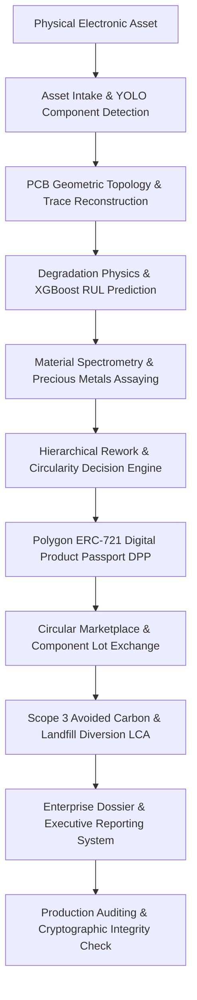

# EcoIntel — Enterprise Circular Electronics Architecture

EcoIntel is an enterprise intelligence platform engineered to close the electronic waste loop across the asset lifecycle: from physical ingestion and multi-layer optical computer vision to physical degradation physics, material spectrometry, repair guidance, blockchain-anchored Digital Product Passports (DPP), a circular component marketplace, Scope 3 avoided carbon accounting, and multi-format enterprise audit reporting.

---

## 1. End-to-End Enterprise Data Pipeline

### Intelligence Pipeline Stages

1. **Optical Capture & YOLOv8 Detection**:
   - Ingests high-resolution optical scans or camera telemetry.
   - Detects surface mount devices (ICs, BGA, capacitors, connectors, transformers).
   - Generates sub-millimeter bounding boxes and confidence intervals.
2. **PCB Topology & OpenCV Reconstruction**:
   - Extracts traces, pads, vias, structural fissures, and burn marks.
   - Reconstructs board dimensions and provides Three.js 3D rendering data.
3. **Physics-Informed RUL Prognostics**:
   - Arrhenius thermal degradation models combined with XGBoost machine learning.
   - Computes statistical prediction intervals for remaining lifespan (hours, cycles, years).
4. **Material Recovery & Precious Metal Matrix**:
   - Elemental stoichiometry based on USGS Minerals Yearbook and WEEE Directives.
   - Computes recoverable grams and rolling spot market values for Gold, Silver, Palladium, Copper, and Tantalum.
5. **IPC-A-610 Circularity Decision Engine**:
   - Prioritizes circular actions: Component Rework > Board Refurbishment > Harvesting > Controlled Smelting.
   - Evaluates economic viability and required technician repair steps.
6. **Polygon Digital Product Passport (DPP)**:
   - Minted on Polygon (Amoy Testnet / Mainnet) with ERC-721 compatible schema.
   - Records immutable lifecycle events (CREATED, ANALYZED, REPAIRED, LISTED, SOLD).
7. **Circular Marketplace**:
   - Trade recovered and refurbished tested components with embedded health and passport verifications.
8. **Scope 3 Avoided Carbon & ESG Intelligence**:
   - Quantifies avoided semiconductor fabrication emissions and landfill diversion in compliance with GHG Protocol Scope 3 and ISO 14044.
9. **Enterprise Reporting & Executive Analytics**:
   - Compiles comprehensive Technical, Circularity, Environmental, and Executive Dossiers with cryptographic provenance.
   - Generates production-grade PDFs with automated completeness scoring and watermarks.

---

## 2. Information Architecture & Routing

| Route | Classification | Purpose |
| :--- | :--- | :--- |
| `/` | Public | Platform Overview, Technology Stack, and Value Proposition |
| `/dashboard` | Authenticated | Executive Overview, 10 KPI Cards, Distributions, Risk Center |
| `/console` | Authenticated | Multi-Stage Interactive Asset Capture & Pipeline Workspace |
| `/reports` | Authenticated | Enterprise Dossier Catalog, Generation Modal, Multi-Format Downloads |
| `/reports/shared/:token` | Secure Public | External stakeholder view with time-bounded cryptographic token |
| `/passport/:id` | Public | Digital Product Passport Verification & Lifecycle Timeline |
| `/marketplace` | Authenticated | Recovered Component Exchange & Batch Procurement |
| `/impact` | Authenticated | Scope 3 Avoided Footprint & Methodology Factor Governance |
| `/organization/data-quality` | Authenticated | Asset Telemetry Completeness Audit & Intake Remediation |
| `/organization/models` | Authenticated | Model Registry, Precision Standards, and Evidence Provenance |
| `/organization/settings` | Authenticated | Report Branding, Default Currency, and Impact Accounting Standards |
| `/notifications` | Authenticated | Real-Time Platform Events & Alert Center |
| `/activity` | Authenticated | Immutable Organizational Lifecycle Audit Trail |
| `/admin` | Admin | Multi-Tenant Governance, User Management, and Factor Policies |

---

## 3. Scientific Honesty & Provenance Hierarchy

EcoIntel enforces strict transparency by tagging every observation and metric with its verified evidence level:

| Evidence Level | Definition | Example Application |
| :--- | :--- | :--- |
| `MEASURED` | Physically measured via calibrated sensors or direct measurement. | Substrate physical dimensions, detected defect coordinates. |
| `KNOWN` | Authoritatively specified in original manufacturer datasheet. | Component package geometry, rated thermal limits. |
| `VERIFIED` | Validated by external authority, ledger, or certified inspection. | Polygon blockchain transaction hash, DPP audit event. |
| `DATABASE-DERIVED` | Extrapolated from authoritative scientific databases. | USGS elemental mass composition, Defra GHG emission factors. |
| `ESTIMATED` | Deterministically calculated via engineering heuristics. | Economic repair viability, technician labor hours. |
| `PREDICTED` | Statistically inferred through trained machine learning models. | XGBoost remaining useful life (RUL), failure risk probability. |
| `INFERRED` | Deduced from partial contextual observations. | Substrate internal copper layer count from surface density. |
| `SIMULATED` | Derived from theoretical environmental simulation. | Hypothetical transport logistics emission savings. |
| `DEMO` | Synthetically generated for platform evaluation. | Benchmark test dataset, sample motherboard telemetry. |
