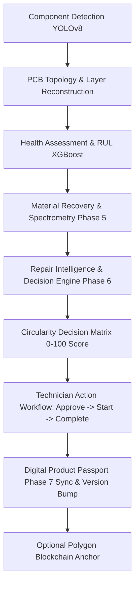

# AI Repair Intelligence & Circularity Decision Engine (Phase 6)

## 1. Executive Summary & Objective

The **EcoIntel AI Repair Intelligence & Circularity Decision Engine** bridges non-destructive optical PCB inspection, health assessment, remaining useful life (RUL) estimation, and material recovery with actionable hardware circularity decisions.

The engine answers critical operational lifecycle questions:
1. **Can this asset or component be repaired?**
2. **Which components should be replaced, reused, refurbished, or recovered for precious metals?**
3. **What specific repair actions are recommended based on observable evidence?**
4. **What is the expected outcome of the repair on board health and longevity?**
5. **Was the repair actually executed and verified on physical hardware?**

> **SCIENTIFIC & LEGAL DISCLAIMER:**  
> **"AI repair recommendations are decision-support outputs and do not constitute confirmation of electrical or mechanical failure."**  
> Optical RGB imagery and parametric models cannot assess internal silicon gate oxide breakdown, latch-up damage, or sub-surface dielectric voids. Recommendations strictly differentiate between **OBSERVED** visual anomalies, **INFERRED** topology degradation, **PREDICTED** lifecycle health, and **VERIFIED** physical workbench measurements.

---

## 2. End-to-End Pipeline Architecture



### Data Consumption & Non-Duplication
The Repair Decision Engine consumes existing artifacts without duplicating raw data:
- `DetectionResult`: Component bounding boxes, packages, coordinates, and classification confidences.
- `PCBAnalysis`: Detected damaged regions (burn marks, scratches, broken traces, corrosion), trace graphs, and pad layer stacks.
- `RULPrediction`: Component-level and board-level health scores (0–100) and remaining useful life (hours & years).
- `MaterialRecovery`: Component precious metal profiles (Au, Ag, Cu, Pd) and hydrometallurgical recovery priorities.

---

## 3. Canonical Action Taxonomy

All recommendations are constrained to canonical, standardized repair actions:

| Action | Description | Prerequisites / Safety |
| :--- | :--- | :--- |
| `INSPECT` | High-magnification optical and microscope inspection | ESD-safe workstation |
| `CLEAN` | Ultrasonic or isopropyl alcohol solvent cleaning | Isolate moisture-sensitive sensors |
| `REWORK` | Hot-air or micro-soldering thermal rework | Follow thermal profile (<350°C) |
| `RESOLDER` | Reflow cold solder joints or bridge micro-fractures | Use no-clean flux & solder wick |
| `REPAIR_TRACE` | Jumper wire installation or conductive epoxy trace repair | Verify continuity with DMM |
| `REPAIR_PAD` | Re-bond lifted copper pad to FR-4 substrate | High-temperature epoxy bonding |
| `REPAIR_CORROSION` | Neutralize electrolyte corrosion & apply conformal coating | Wear chemical-resistant gloves |
| `REPLACE_COMPONENT` | De-solder degraded part and solder new certified unit | Match footprint & voltage rating |
| `REPLACE_CONNECTOR` | Replace mechanically worn or loose I/O header | Verify pinout alignment |
| `REPLACE_CAPACITOR` | Replace bulged or high-ESR electrolytic/MLCC capacitor | Discharge capacitor prior to removal |
| `REPLACE_IC` | BGA/QFP desoldering, reballing, or replacement | Qualified technician inspection required |
| `ELECTRICAL_TEST` | In-circuit resistance, diode drop, and power rail test | Current-limited bench power supply |
| `FUNCTIONAL_TEST` | Firmware boot and signal loopback validation | Bench test harness |
| `MATERIAL_RECOVERY` | Hydrometallurgical precious metal extraction | Component not economically repairable |
| `REUSE` | Direct redeployment in second-life hardware | Certified Mint / Healthy condition |
| `REFURBISH` | System-level firmware update, cleaning & casing renewal | Complete secondary functional test |
| `RECYCLE` | Mechanical shredding and base material separation | Substrate or components unrepairable |
| `RETIRE` | Safe decommission and hazardous waste handling | Proper e-waste disposal standard |

---

## 4. Component Repairability Classification

Each detected component receives one of six unambiguous repairability statuses:

1. **`REPAIRABLE`**: Localized solder joint or pin oxidation; component package and silicon intact.
2. **`LIKELY_REPAIRABLE`**: Minor visual anomalies with moderate health; expected recovery > 80%.
3. **`CONDITIONALLY_REPAIRABLE`**: Severe physical or trace damage requiring specialized tools or rare replacement parts.
4. **`NOT_REPAIRABLE`**: Severe core die cratering, delamination, or package disintegration.
5. **`REQUIRES_INSPECTION`**: Insufficient visual clarity or ambiguous damage severity; physical bench probe needed.
6. **`UNKNOWN`**: Insufficient optical telemetry or confidence below threshold.

---

## 5. Circularity Decision Matrix & Scoring Model

The whole asset is evaluated against 8 circularity pathways with an overall **Circularity Decision Score (0–100)**:

$$\text{Decision Score} = \sum (w_i \cdot F_i)$$

Where factors $F_i$ comprise:
- **Repairability Index (25%)**: Ratio of repairable vs unrepairable components and substrate continuity.
- **Board Health Index (20%)**: Output from XGBoost degradation physics model.
- **Remaining Useful Life (15%)**: Projected operating hours remaining.
- **Damage Severity Inversion (15%)**: Penalizes extensive burned substrate areas or delamination.
- **Component Availability (10%)**: Standard packaging availability (SMD/QFP vs custom ASICs).
- **Material Recovery Potential (10%)**: Precious metal yield potential if direct repair is unfeasible.
- **Reusability Potential (5%)**: Secondary application viability.

### Decision Matrix Options:
1. `REUSE`: Asset health $\ge 80\%$, zero severe damage.
2. `REPAIR`: Localized repairable anomalies; high restoration potential.
3. `REFURBISH`: Moderate aging; suitable for secondary consumer or industrial markets.
4. `REMANUFACTURE`: Disassemble to module level for industrial rebuilding.
5. `RECOVER`: Health $< 50\%$ but contains high precious metal density (e.g. gold-plated headers or high-Pd MLCCs).
6. `RECYCLE`: Low recovery value, high substrate damage; mechanical recycling.
7. `RETIRE`: Hazardous materials or complete physical degradation.
8. `INSPECT`: Telemetry uncertainty exceeds confidence threshold.

---

## 6. Governed Repair Workflow & Provenance

To guarantee operational and scientific honesty, AI recommendations **never** become completed repairs automatically:

```
[AI Assessment] 
       ↓ status: RECOMMENDED
[Operator / Lead Review]
       ↓ POST /recommendations/:id/approve
[Approved by Authority]
       ↓ status: APPROVED
[Technician Begins Work]
       ↓ POST /recommendations/:id/start
[Work in Progress]
       ↓ status: IN_PROGRESS
[Technician Bench Test]
       ↓ POST /recommendations/:id/complete
   ├── If Functional Test PASS:
   │     • status: COMPLETED
   │     • Store beforeHealth & afterHealth (verified measurements)
   │     • Append REPAIRED event to Phase 7 Digital Passport
   │     • Increment Passport Version (v1.0 -> v2.0)
   │     • Recalculate SHA-256 Content Hash
   └── If Functional Test FAIL:
         • status: CANCELLED / FAILED
         • Do NOT claim improved health
         • Log REPAIR_FAILED audit event
```

---

## 7. Phase 7 Digital Product Passport Integration

Phase 6 cleanly integrates into the existing Phase 7 DPP architecture without rebuilding or altering passport primitives:
- On verified repair completion (`PASS`), the repair service calls:
  ```ts
  await passportService.addLifecycleEvent(passportId, {
    eventType: "REPAIRED",
    description: `Executed action '${action}' on component '${componentId}'. Result: Functional test PASS.`,
    actor: technicianId,
    evidence: JSON.stringify(evidenceDocuments),
    metadata: { recommendationId, action, componentId, replacementPartNumber, functionalTest: "PASS" }
  });
  ```
- This automatically:
  1. Creates an immutable `IPassportEvent`.
  2. Updates `repairSummary.performedActions` and sets `repairSummary.repairStatus = "COMPLETED"`.
  3. Increments passport `version` (e.g., $1 \rightarrow 2$).
  4. Stores a snapshot in `versionHistory`.
  5. Computes a new canonical SHA-256 hash using the previous version's hash as input.
  6. Allows the existing `BlockchainProvider` to register the new version anchor on Polygon POS.

---

## 8. What-If Digital Twin Simulation

The platform includes an isolated **What-If Repair Simulator**:
- Route: `POST /api/repair/:analysisId/simulate`
- Input: `{ componentId: string, action: string }`
- Output: Hypothetical delta on component health, whole-board health, projected RUL, and circularity score.
- **Guarantee**: Isolated calculation. Does **NOT** alter the MongoDB `AnalysisSession`, `RepairAssessment`, or `DigitalPassport`.
- Clearly labeled in the UI as **`AI SIMULATION (HYPOTHETICAL WHAT-IF ESTIMATE)`**.

---

## 9. API Reference

| Method | Endpoint | Description |
| :--- | :--- | :--- |
| `POST` | `/api/repair/analyze` | Initiates repair assessment analysis (BullMQ / Direct) |
| `GET` | `/api/repair/:analysisId` | Retrieves full `RepairAssessment` document |
| `GET` | `/api/repair/:analysisId/components` | Retrieves component repairability assessments |
| `GET` | `/api/repair/:analysisId/recommendations` | Retrieves repair recommendations list |
| `GET` | `/api/repair/:analysisId/circularity` | Retrieves circularity decision and decision matrix |
| `POST` | `/api/repair/:analysisId/recommendations/:id/approve` | Authorizes a repair recommendation |
| `POST` | `/api/repair/:analysisId/recommendations/:id/start` | Marks repair recommendation as `IN_PROGRESS` |
| `POST` | `/api/repair/:analysisId/recommendations/:id/complete` | Submits technician notes, test results, updates passport |
| `POST` | `/api/repair/:analysisId/recommendations/:id/reject` | Rejects recommendation with documented reason |
| `POST` | `/api/repair/:analysisId/simulate` | Runs isolated what-if replacement simulation |

---

## 10. Audit Logging & Security

All actions log immutable records in `AuditLog`:
- `REPAIR_ASSESSMENT_REQUESTED`
- `REPAIR_ASSESSMENT_STARTED`
- `REPAIR_ASSESSMENT_COMPLETED`
- `REPAIR_RECOMMENDATION_APPROVED`
- `REPAIR_STARTED`
- `REPAIR_COMPLETED`
- `REPAIR_FAILED`
- `REPAIR_REJECTED`

Multi-tenant organization isolation is enforced across all endpoints: non-admin users cannot access or execute repair actions on sessions owned by foreign organizations.
